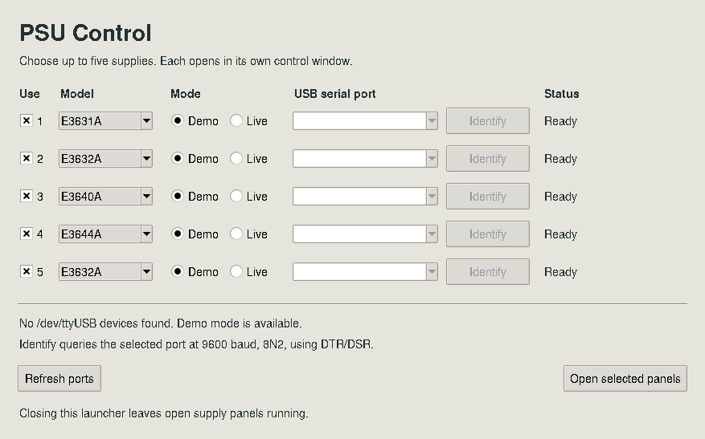
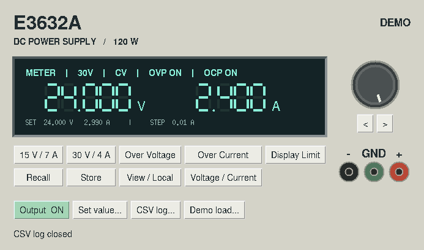
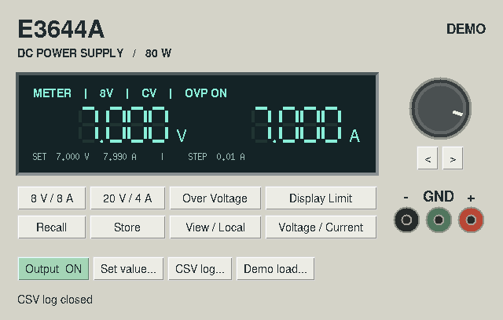

# PSU Control 0.4.0

A Python/Tk X11 launcher for up to five supplies, with four model-specific panels, RS-232 control, offline demos, and a CLI. Start the script matching the front-panel model. A live session checks the model identity and reads the existing settings before enabling the controls. Closing the app requests local control and sends no output command.

## Run

Ubuntu 22.04: install python3 and python3-tk. RHEL 8: install python3 and python3-tkinter. Use the distribution Python (3.6 or newer) and a working X display. No pip packages or build step.

Start the launcher from the repository directory.

    python3 psu_control.py

Check **Use** for each required row, select the model, and choose **Demo** or **Live**. Live rows enable the **USB serial port** dropdown, populated from `/dev/ttyUSB*`. Click **Refresh ports** after attaching an adapter or passing it through to a VM. The launcher keeps a blank port selection until you choose one. A removed idle port is cleared on refresh.

Click **Open selected panels** to open up to five separate control windows. You can use multiple supplies of the same model and mix live and demo rows. Rows lock while their panels are open. Close a panel to reuse its row. A repeated click opens only selected rows that have no panel yet. The launcher rejects duplicate live-port assignments before starting the batch.

**Identify** queries only the chosen port with `*IDN?` using 9600 baud, 8N2 and DTR/DSR. On a supported reply it selects the detected model in that row. It sends no remote-mode, output or setpoint commands. Identification has a timeout and runs in the background. The adapter must be attached to the powered supply, with the supply's RS-232 settings and cable configured correctly. Unresponsive ports and unsupported identities are reported. The live panel also verifies the model when it opens.

USB enumeration alone identifies the adapter. The instrument's SCPI reply identifies the supply attached to it. The launcher probes a port only when you click Identify. Device numbers can change after unplugging adapters, so check selections after reconnecting them.

**Live panel open** means the panel process is running. Check the panel itself for communication status and readings. Closing the launcher leaves the supply panels running, with each panel responsible for its own output and return-to-local behavior.

Each model panel can also be started directly.

    python3 e3631a.py --demo
    python3 e3640a.py --demo
    python3 e3632a.py --demo
    python3 e3644a.py --demo

For live operation select RS-232 on the supply, 9600 baud and no parity (8 data bits, two stop bits). Use a true RS-232 adapter, a DTE-to-DTE null-modem cable carrying DTR/DSR and an accessible Linux serial device. Close any other open session on that port.

    python3 e3631a.py --port /dev/ttyUSB0 --status
    python3 e3631a.py --port /dev/ttyUSB0

## E3631A operation

- Select +6 V (5 A), +25 V (1 A) or -25 V (1 A). The meter, dial, setpoint entry and CV/CC annunciator follow the selected output. Negative rail voltages are signed. All three current limits use positive amperes.
- **All outputs** enables or disables all three rails together.
- **Track +/-25 V** initially sets the negative rail to match the positive rail in magnitude. Adjusting either voltage then mirrors it on the other. Current limits stay independent. Enabling tracking while live can change the load voltage immediately. Existing instrument trigger coupling can conflict with tracking. The app reports the instrument error and leaves the coupling configuration under operator control.
- **Voltage / Current** selects the knob function. Use its mouse wheel, a vertical drag, or Up/Down. Left/Right changes the step. **Set value** accepts a numeric entry. **Display Limit** toggles between programmed and measured values.
- **Store / Recall** use memories 1–3 and include the global output state. Recalling an unwritten location restores instrument reset settings. Demo memories last for the session.
- **Demo load** sets the resistance on the selected rail. Try **-25 V**, then **All outputs**. The default -12 V setting, 1 A limit and 10 ohm load yield -10 V, 1 A and CC. Change the load to 24 ohms to see -12 V, 0.5 A and CV.
- **CSV log** records the currently selected rail on each readback and includes its identifier and tracking state in every row. Voltage and current are successive measurements. **View / Local** returns a live session to local control and closes the panel.
- There is no E3640A-style OVP menu on this panel. Trigger sequencing and calibration are outside this release.

## E3631A CLI

    python3 e3631a.py --port /dev/ttyUSB0 --rail N25V --set voltage -12
    python3 e3631a.py --port /dev/ttyUSB0 --rail N25V --set current 0.5
    python3 e3631a.py --port /dev/ttyUSB0 --set track on
    python3 e3631a.py --port /dev/ttyUSB0 --set output on
    python3 e3631a.py --port /dev/ttyUSB0 --set output off

Voltage and current commands require an explicit rail. Global commands omit --rail. A plain --status reads the current selection. Adding --rail to --status explicitly selects that rail on the instrument. CLI demo invocations each start a fresh simulation.

## E3640A

The E3640A keeps its existing CLI, range selection, OVP menu, five instrument memories and CSV format. See [E3640A.md](E3640A.md) for its operating instructions.

## E3632A and E3644A

| Model | Low range | High range | Protection | Memories |
| --- | --- | --- | --- | --- |
| E3632A | 15 V / 7 A | 30 V / 4 A | OVP 1–32 V, OCP 0–7.5 A | 1–3 |
| E3644A | 8 V / 8 A | 20 V / 4 A | OVP 1–22 V | 1–5 |

Both panels use the familiar display, knob, digit selection, range keys, setpoint entry, Display Limit, Store/Recall and Output controls. Setpoint entry uses the nominal range ratings. The E3632A includes its separate Over Current key with threshold, enable/disable and trip-clear actions. Its CSV log also records OCP threshold, enable and trip state. Each launcher checks its exact instrument model before entering remote control. Connection setup is 9600 baud, 8N2, with DTR/DSR null-modem wiring as for the other supplies.

    python3 e3632a.py --port /dev/ttyUSB0 --status
    python3 e3632a.py --port /dev/ttyUSB0
    python3 e3644a.py --port /dev/ttyUSB0 --status
    python3 e3644a.py --port /dev/ttyUSB0

CLI examples (close the GUI on that port first). Range and setpoint changes take effect immediately.

    python3 e3632a.py --port /dev/ttyUSB0 --set range P30V
    python3 e3632a.py --port /dev/ttyUSB0 --set voltage 24
    python3 e3632a.py --port /dev/ttyUSB0 --set ocp 3
    python3 e3644a.py --port /dev/ttyUSB0 --set range P8V
    python3 e3644a.py --port /dev/ttyUSB0 --set current 8

For an E3632A demo OCP check, enable output at the initial 5 V / 1 A setting and 10 ohm load. In Over Current, set a 0.4 A trip threshold. OCP TRIPPED appears and the readings drop to zero. Raise the threshold to 0.8 A, then Clear OCP trip to restore the output. Clearing OVP or OCP on the physical supply can also re-energize the load. Demo OCP is an ideal instantaneous threshold with a latch and omits analog timing and transients. Demo memory recall from an unused E3632A slot restores its reset settings.

## Validation

Run `python3 -m unittest -v` in this directory. Thirteen tests cover the existing E3640A/E3631A behavior, the new current limits and ranges, model identification, E3632A OCP commands and latching, memory recall and CLI bounds, plus launcher command generation, port ordering and identity-query cleanup. All four panels were exercised under X11 with demo devices, including controls, CSV logging and orderly shutdown. The user confirmed the 0.2.0 demo runs on RHEL 8. The 0.4.0 launcher was exercised under X11 with five actual demo panel processes, repeat launching, child restart, launcher closure, port-refresh handling and simulated identity replies. The new launcher and panels await RHEL 8 and physical instrument verification.

The applications retain Python 3.6 compatibility. Version 0.3.0 also cancels the GUI polling callback on close to prevent a pending callback from running after the window is destroyed.

[Keysight E3631A User's Guide](https://www.keysight.com/us/en/assets/9018-01308/user-manuals/9018-01308.pdf), especially pp. 91–96, 105 and 114.

[Keysight E3632A User's Guide](https://www.keysight.com/us/en/assets/9018-01309/user-manuals/9018-01309.pdf), output ranges, OVP/OCP and serial command reference.

[Agilent E3632A User's Guide mirror](https://www.tme.com/Document/0f1b21d5b1a61490620d3893d53ad5aa/E3632-90001.pdf), pp. 18–20, 87–92, 99–100 and 155.

[Keysight E364xA Single Output User's and Service Guide](https://www.keysight.com/us/en/assets/9018-01165/user-manuals/9018-01165.pdf), including E3644A ranges and SCPI commands.
